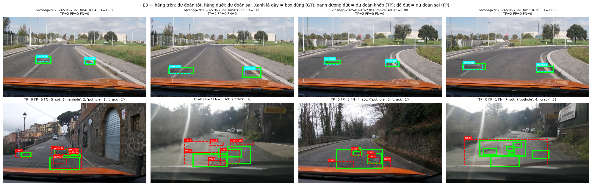
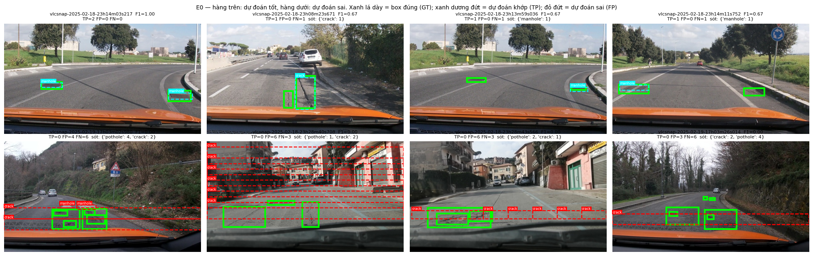

Họ tên: [[TODO: họ tên]]
`dataset_version`: d10-21e4070301

> Các số liệu lấy từ thí nghiệm (F1, CI95, FP/ảnh, VRAM, phút, hiệu F1 ghép cặp) được điền tự động từ `report/evidence/*.json` bằng `python lab/fill_report.py` (không gõ tay, để luôn khớp với bằng chứng). Các số khác (tham số từng khối, số ảnh/box, kiểm tra rò rỉ, kiểm tra thang toạ độ "oracle") là số mình tự đo bằng các cell trong `lab_day10.ipynb` (mục 1, 2, 4, 5), chạy được không cần GPU.

## Bảng tổng hợp (số của bạn, lấy từ `report/evidence/*.json`)

| Mã | Setup | Tham số huấn luyện | VRAM đỉnh (GB) | Phút | F1 | CI95 | FP/ảnh | F1 pothole | F1 crack | F1 manhole |
|---|---|---|---|---|---|---|---|---|---|---|
| E0 | zero-shot | 0 | – (không huấn luyện) | – | 0.072 | [0.051, 0.096] | 1.30 | 0.158 | 0.020 | 0.146 |
| E1 | LoRA LLM | 33,030,144 | 6.14 | 52.19 | 0.270 | [0.233, 0.308] | 1.26 | 0.193 | 0.190 | 0.539 |
| E2 | + projector | 142,135,296 | 11.53 | 53.03 | 0.330 | [0.293, 0.370] | 1.09 | 0.165 | 0.273 | 0.593 |
| E3 | + LoRA ViT | 148,426,752 | 10.20 | 75.85 | 0.435 | [0.394, 0.480] | 0.87 | 0.251 | 0.359 | 0.730 |
| E4 | coord_scale = norm1000 (= setup gốc) | 148,426,752 | 10.20 | 75.85 | 0.435 | [0.394, 0.480] | 0.87 | 0.251 | 0.359 | 0.730 |
| E4 | coord_scale = pixel | {{e4_coord_scale_pixel.params}} | {{e4_coord_scale_pixel.vram}} | {{e4_coord_scale_pixel.min}} | {{e4_coord_scale_pixel.f1}} | {{e4_coord_scale_pixel.ci}} | {{e4_coord_scale_pixel.fp}} | {{e4_coord_scale_pixel.f1_pothole}} | {{e4_coord_scale_pixel.f1_crack}} | {{e4_coord_scale_pixel.f1_manhole}} |

Bổ sung (cùng nguồn): `parse_valid_rate` E0/E1/E2/E3 = 0.752 / 1.000 / 1.000 / 1.000; mean IoU của các cặp khớp = 0.613 / 0.677 / 0.669 / 0.692. Bảng đầy đủ hơn (P, R, meanIoU) do notebook sinh ra ở `report/summary_table.md`.

**Ghi chú về cách chạy.** E0 và bước *huấn luyện* E1 chạy khi `load_base_model` còn lỗi lượng tử hoá nhầm ViT (câu 5), nên ViT/projector của hai lượt này ở 4-bit. E1 được *đánh giá* và E2, E3 chạy hoàn toàn với ViT fp16. E3 hết VRAM với batch 2 nên chạy batch 1 × tích luỹ 8 (batch hiệu dụng vẫn là 8, lr và số bước như E1/E2). Thời gian thật mỗi lần huấn luyện là 52–76 phút, gấp đôi ước lượng 20–30 phút của README. Log đầy đủ của lượt chạy này nằm ở `report/notebook_run1_E0-E3.ipynb`.

**Ảnh minh hoạ** (sinh trong notebook, mục 7):





- `report/figures/qualitative_e3.png` — 8 ảnh test của setup tốt nhất (E3): hàng trên 4 ảnh dự đoán tốt, hàng dưới 4 ảnh sai nhiều nhất. Xanh lá dày = box đúng (GT), xanh dương đứt = dự đoán khớp (TP), đỏ đứt = dự đoán sai (FP); tiêu đề ghi TP/FP/FN và lớp bị sót.
- `report/figures/qualitative_e0.png` — cùng kiểu cho E0 zero-shot.
- `report/figures/compare_runs.png` — 3 ảnh nhiều box nhất qua E0 → E1 → setup tốt nhất.
- `report/figures/recall_by_size_e3.png`, `report/figures/results_overview.png`, `report/figures/loss_curves.png`, `report/figures/e4_coord_scale.png`, `report/figures/data_samples.png`, `report/figures/data_stats.png`, `report/figures/leak_check.png`, `report/figures/label_roundtrip.png`.

## 10 câu hỏi (trả lời bằng **số của bạn**, không chép lại tài liệu)

### Câu 1 — Kiến trúc: ViT, projector và LLM của Qwen3-VL-4B có bao nhiêu tham số mỗi khối, và E1/E2/E3 mỗi cái cập nhật khối nào?

Mình đếm trên cây module thật của `Qwen3VLForConditionalGeneration` (dựng trên thiết bị `meta` nên không cần tải trọng số, hàm `param_report()` trong notebook mục 5):

| Khối | Tên module | Tham số |
|---|---|---|
| ViT (24 khối + patch_embed + pos_embed) | `model.visual.blocks`, ... | 306.242.560 |
| Projector chính | `model.visual.merger` | 27.271.680 |
| Projector DeepStack (3 merger, lấy đặc trưng ở lớp 5, 11, 17 của ViT) | `model.visual.deepstack_merger_list` | 81.833.472 |
| → toàn bộ `model.visual` | | 415.347.712 |
| LLM (36 lớp decoder, gồm embedding) | `model.language_model` | 4.022.468.096 |
| trong đó `embed_tokens` (151.936 × 2.560, **dùng chung** với `lm_head`) | | 388.956.160 |
| **Tổng** | | **4.437.815.808** |

Luồng dữ liệu: ảnh 640×360 → processor resize về 640×352 → 22×40 = 880 patch 16×16 → ViT → `merger` gộp 2×2 patch thành **220 token** 2.560 chiều đưa vào LLM; 3 merger DeepStack cộng thêm đặc trưng tầng giữa của ViT vào 3 lớp đầu của LLM. LLM sinh JSON.

Cập nhật trong từng thí nghiệm (LoRA r=16, α=32 trên các `nn.Linear`):

- **E1**: chỉ LoRA trên 252 module của LLM (36 lớp × `q,k,v,o,gate,up,down`) = **33.030.144** tham số (0,74% model). ViT, projector, embedding đóng băng; LLM gốc ở dạng 4-bit NF4. (Lượt huấn luyện E1 của mình có ViT ở 4-bit do lỗi ở câu 5; số tham số học không đổi.)
- **E2**: E1 + **mở toàn bộ projector** (`merger` + `deepstack_merger_list`, fp32) = 33.030.144 + 109.105.152 = **142.135.296**.
- **E3**: E2 + LoRA trên 96 module của ViT (24 khối × `attn.qkv, attn.proj, mlp.linear_fc1, mlp.linear_fc2`) thêm 6.291.456 → **148.426.752**. Thân ViT vẫn đóng băng, chỉ học phần LoRA.

Số `trainable_params` trong bằng chứng: E1 = 33,030,144, E2 = 142,135,296, E3 = 148,426,752, khớp với số mình tính trước. E2 − E1 đúng bằng 109.105.152 ≈ 109M như GUIDE.

### Câu 2 — E0: `parse_valid_rate` bằng bao nhiêu, và hai lỗi phổ biến nhất của model gốc là gì (kèm một ví dụ output thô)?

`parse_valid_rate` của E0 = **0.752**, F1 = 0.072 (P = 0.084, R = 0.063), FP/ảnh = 1.30.

Mình phân loại lỗi bằng hàm `diagnose()` (notebook, cell sau mục 3). Hàm này gắn nhãn cho từng ảnh: JSON hỏng, bọc ```json, chữ thừa, box bịa (IoU < 0,1 với mọi box đúng), sai lớp, box lệch (0,1 ≤ IoU < 0,5), toạ độ > 1000. Hai lỗi nhiều nhất:

1. **Box sai vị trí:** 138/311 ảnh (44,4%) có box lệch (cùng lớp nhưng 0,1 ≤ IoU < 0,5) và 105 ảnh (33,8%) có box bịa (IoU < 0,1 với mọi box đúng). Lớp crack tệ nhất: 306 FP và chỉ 6 TP (F1 0,020). Model hay vẽ một box crack bao cả mặt đường, ví dụ `vlcsnap-00201` → `[{"label": "crack", "bbox_2d": [1, 457, 1000, 999]}]`.
2. **JSON hỏng vì lặp vô hạn:** toàn bộ 77 ảnh (24,8%) không parse được đều cùng một kiểu. Model "lát gạch" các box crack bé xíu cạnh nhau cho đến khi hết `max_new_tokens=256`, nên JSON bị cắt giữa chừng. 64/77 output dài đúng 413 ký tự.

Ví dụ output thô (ảnh `vlcsnap-00210`, bị cắt ở token thứ 256):

```
[{"label": "crack", "bbox_2d": [500, 478, 509, 486]}, {"label": "crack", "bbox_2d": [509, 478, 517, 486]}, {"label": "crack", "bbox_2d": [517, 478, 525, 486]}, {"label": "crack", "bbox_2d": [525, 478, 533, 486]}, ...
```

Mình cũng kiểm tra xem model gốc có đang trả pixel thay vì 0–1000 không: chấm lại `work/e0.jsonl` với `--coord pixel` thì F1 = **0,000**. Còn `coord_stats()` cho thấy 95,7% box có y > 360, toạ độ lớn nhất đúng 1000. Kết luận: model gốc **dùng đúng thang 0–1000** (quy ước grounding của Qwen3-VL). Lỗi của nó là định vị và vòng lặp sinh, không phải sai thang.

### Câu 3 — Thang 0–1000: nếu chấm output theo pixel (hoặc ngược lại) thì F1 ra sao và vì sao? Bạn đã kiểm chứng điều này thế nào?

F1 gần như **sụp về 0**. Mình kiểm chứng bằng ba cách:

1. **Oracle, không cần GPU** (`coord_mismatch_demo()`, notebook mục 2): đổi chính đáp án đúng của 311 ảnh test thành JSON rồi chấm bằng `scripts/score.py`:

   | Nhãn viết theo | Chấm với `--coord norm1000` | Chấm với `--coord pixel` |
   |---|---|---|
   | 0–1000 | F1 = **1,000** (mean IoU 0,988) | F1 = **0,000** |
   | pixel 640×360 | F1 = **0,000** | F1 = **1,000** (mean IoU 1,000) |

   Đáp án hoàn hảo mà chỉ lệch thang cũng chỉ còn 0 TP. Lý do: box pixel (x ≤ 640, y ≤ 360) khi bị đọc như thang 0–1000 sẽ bị **co lại 0,64 lần theo x và 0,36 lần theo y** về phía góc trên-trái. Ngược lại, box 0–1000 đọc như pixel bị phóng 1,56 lần / 2,78 lần (nhiều box rơi ra ngoài khung). Box ở đây rất nhỏ (diện tích trung vị: pothole 0,38%, manhole 0,46%, crack 1,42% khung hình), nên chỉ cần dịch vài chục pixel là IoU < 0,5, tức là không còn cặp nào khớp.
2. **Trên output thật của model**: chấm lại dự đoán của E3 (setup tốt nhất) với `--coord pixel`: F1 từ **0,435 xuống 0,000** (P = R = 0, FP/ảnh tăng từ 0,87 lên 1,64). Với E0 cũng vậy: 0,072 → 0,000.
3. **E4 (coord_scale)**: huấn luyện lại với nhãn + prompt theo pixel và chấm đúng `--coord pixel` thì F1 = {{e4_coord_scale_pixel.f1}} (so với 0.435 khi dùng 0–1000). Như vậy thang nào cũng học được, miễn là **nhãn, prompt và cách chấm cùng một thang**. Xem câu 10.

Vì sao Qwen3-VL dùng 0–1000: toạ độ tương đối **không phụ thuộc độ phân giải**. Processor luôn resize ảnh (ở đây 640×360 → 640×352 để chia hết cho 32), và mỗi ảnh khác cỡ sẽ có dải pixel khác nhau. Còn 0–1000 là quy ước cố định mà model đã thấy khi pretrain grounding.

Một chi tiết mình tự phát hiện: nhãn gốc của dataset **khớp đúng lưới pixel** (quy ngược về pixel sai số 0,001 px), nên làm tròn sang 0–1000 mất một chút độ chính xác (sai số tối đa 0,32 px, mean IoU của oracle 0,988 thay vì 1,000). Mất mát này không đổi F1@0,5 nhưng có ảnh hưởng nếu chấm ở IoU cao hơn.

### Câu 4 — Mask loss: vì sao chỉ tính loss trên phần trả lời? Điều gì xảy ra nếu tính trên cả prompt và token ảnh?

Mình đặt `labels = -100` cho toàn bộ phần prompt (`encode_example`). Trước đó có kiểm tra bằng `assert` rằng prompt (đã thêm generation prompt) là **tiền tố đúng** của chuỗi đầy đủ. Giải mã riêng các token có `labels != -100` thì ra đúng JSON đáp án + `<|im_end|>`.

Đo trên 200 ảnh train: mỗi mẫu có **405 token prompt** (trong đó **220 token ảnh** `<|image_pad|>` và khoảng 185 token chữ của template + câu lệnh), còn câu trả lời chỉ có trung vị **59 token**, tức khoảng **15%** chuỗi. Nếu tính loss trên tất cả:

- **85% tín hiệu loss rơi vào token không cần học.** Prompt chữ giống hệt nhau ở mọi mẫu, nên model chỉ học thuộc câu lệnh. 220 token ảnh đều là cùng một id `<|image_pad|>` lặp lại, nên đoán "token tiếp theo vẫn là image_pad" là việc vô nghĩa, không dạy gì về vị trí hư hại. Loss trung bình bị pha loãng khoảng 6–7 lần, gradient cho phần JSON (phần duy nhất có ích) yếu hẳn với cùng lr.
- **Loss mất ý nghĩa để theo dõi:** phần dễ (prompt lặp lại) nhanh chóng về gần 0 và kéo loss tổng xuống, trong khi phần grounding chưa học được.
- **Model học sai hành vi:** nó được thưởng khi sinh lại câu lệnh/token ảnh, nên dễ lặp prompt hoặc sinh token đặc biệt thay vì JSON, làm `parse_valid_rate` giảm.

Lúc suy luận prompt luôn được cho sẵn, nên chỉ phân phối của **câu trả lời có điều kiện theo ảnh + prompt** mới cần tối ưu.

### Câu 5 — Vì sao không thể huấn luyện đầy đủ projector nếu ViT bị lượng tử hoá 4-bit, và bạn đã xử lý thế nào? Vì sao projector phải ở float32?

Khi lượng tử hoá 4-bit, bitsandbytes thay mỗi `nn.Linear` bằng `Linear4bit`. Trọng số được nén thành `Params4bit` (2 giá trị NF4 trong một byte uint8, kèm hệ số absmax theo block 64). Đây không phải tensor số thực nên **không có gradient** và optimizer không cập nhật trực tiếp được. NF4 chỉ có 16 mức giá trị, nên dù có giải nén → cập nhật → nén lại thì các bước cập nhật nhỏ (lr 2e-4) cũng bị làm tròn mất. Với tầng 4-bit chỉ có thể học **thêm LoRA bên cạnh**, không thể "huấn luyện đầy đủ". Projector nằm trong `model.visual`, nên nếu lượng tử hoá cả ViT thì `merger` cũng thành 4-bit và E2/E3 không còn đúng nghĩa.

Cách mình xử lý: `BitsAndBytesConfig(..., llm_int8_skip_modules=["model.visual", "lm_head"])`. Mọi module dưới `model.visual` (ViT + `merger` + `deepstack_merger_list`) và `lm_head` được giữ fp16, chỉ 252 Linear của LLM bị nén NF4.

Mình gặp đúng lỗi này khi chạy thật. Lúc đầu mình dùng `["visual", "lm_head"]` như pseudo code của GUIDE, nhưng transformers 5.19 so khớp tên bằng `re.match` (neo ở **đầu** tên đầy đủ) hoặc `endswith`. Vì vậy `"visual"` không khớp `model.visual.merger.linear_fc1`, và cả ViT lẫn projector bị nén 4-bit. Dấu hiệu: E2 báo projector chỉ có 54.579.200 tham số (gần đúng một nửa 109.105.152, vì bitsandbytes gói 2 giá trị 4-bit vào một byte nên `numel()` giảm một nửa). Sau đó `GradScaler.unscale_()` báo `Attempting to unscale FP16 gradients`. Mình sửa thành tiền tố đầy đủ `"model.visual"`, thêm `assert` trong `load_base_model` (không có `Linear4bit` nào dưới `model.visual`, đúng 252 `Linear4bit` trong LLM) và trong `apply_setup` (tham số projector phải là số thực). Lỗi được phát hiện sau khi E0 và E1 đã chạy, nên E0 và lượt huấn luyện E1 có ViT 4-bit; vì giới hạn thời gian Colab mình không chạy lại hai lượt này mà ghi rõ ở đây và ở câu 7. Ở E2/E3 mình đổi riêng 109.105.152 tham số projector sang **float32** và bật `requires_grad`.

Vì sao float32:

- Huấn luyện dùng `autocast(fp16)` + `GradScaler`. `GradScaler.unscale_()` **từ chối gradient fp16** ("Attempting to unscale FP16 gradients"), nên tham số được tối ưu phải là fp32. Đây cũng là lý do peft tự đưa trọng số LoRA lên fp32.
- fp16 chỉ có 10 bit mantissa. Khi lr giảm theo cosine về 0, các bước cập nhật nhỏ bị làm tròn mất. Moment bậc hai của Adam (≈ g², với g ~ 1e-4 là ~1e-8) thấp hơn ngưỡng nhỏ nhất của fp16 nên bị underflow, chia cho số gần 0 thì bước cập nhật nổ.
- Trong forward, `autocast` vẫn tính matmul của merger ở fp16, nên dtype không xung đột với ViT fp16.

Cái giá: 109M tham số fp32 cần ≈ 0,44 GB trọng số + 0,44 GB gradient + 0,87 GB trạng thái Adam ≈ **1,75 GB** VRAM thêm so với E1. Đo được: E2 11.53 GB so với E1 6.14 GB, tức +5,39 GB. Phần dư ngoài 1,75 GB đến từ việc ViT ở E2 là fp16 (E1 khi huấn luyện còn 4-bit) và activation phải giữ lại để lan ngược vào projector (merger chính + 3 merger DeepStack nối vào 3 lớp đầu LLM). Mình không tách riêng được từng phần. Khi lưu, mình lưu projector riêng (`projector.safetensors`), vì `save_pretrained` của peft chỉ lưu LoRA. Lúc suy luận, `load_for_inference()` nạp lại và **in độ lệch |Δ| so với projector gốc** để chắc chắn đã nạp đúng bản đã huấn luyện. Thiếu bước này thì E2/E3 trông y như E1.

### Câu 6 — Split theo phiên quay: vì sao chia ngẫu nhiên sẽ cho F1 cao giả? Số ảnh và số box từng lớp ở mỗi split là bao nhiêu?

Ảnh là các frame cắt từ video dashcam (xe chạy 20–50 km/h). Hai frame cách nhau vài giây gần như trùng nhau: cùng con đường, cùng ổ gà, box ở gần cùng vị trí. Nếu chia ngẫu nhiên, frame "anh em" của ảnh test nằm trong train, và model chỉ cần **nhớ cảnh** là đoán đúng. F1 khi đó đo khả năng học thuộc chứ không đo khả năng tổng quát sang đoạn đường mới.

Mình đo trực tiếp bằng `leak_check()` (notebook mục 1). Với mỗi ảnh test, mình tìm ảnh train gần nhất theo khoảng cách L2 trên thumbnail xám 32×18:

| | Split theo phiên (đề) | Split ngẫu nhiên (cùng 311 ảnh test, 3 seed) |
|---|---|---|
| Khoảng cách tới ảnh train gần nhất (trung vị) | 3,72 | 2,68 – 2,73 |
| % ảnh test có "bản gần trùng" trong train (d < 2,76) | 5,1% | **51,1% – 54,0%** |

Với split ngẫu nhiên, hơn một nửa ảnh test có bản gần trùng trong train. Ví dụ `vlcsnap-2025-02-19-15h02m56s842` (test) và `...15h03m10s511` (train) cách nhau 14 giây, d = 0,01, nhìn bằng mắt không phân biệt được (`report/figures/leak_check.png`). F1 trên split như vậy sẽ cao giả. Split của đề gom 18 phiên quay (`session` = ngày + giờ, hoặc nhóm 50 số với `vlcsnap-000xx`) thành 13 / 2 / 3 phiên cho train / val / test, và mình đã `assert` rằng không phiên nào nằm ở hai split.

| Split | Phiên | Ảnh | Box | pothole | crack | manhole |
|---|---|---|---|---|---|---|
| train | 13 | 1.422 | 3.515 | 1.074 | 1.750 | 691 |
| val | 2 | 276 | 639 | 66 | 470 | 103 |
| test | 3 | 311 | 583 | 121 | 299 | 163 |

Hệ quả: phân bố lớp lệch (val chỉ có 66 pothole). Ngoài ra, test chỉ đến từ 3 phiên nên các ảnh test **không độc lập** với nhau, xem câu 8.

### Câu 7 — So sánh E1/E2/E3: mở projector và LoRA trên ViT có đáng không (F1, CI95, VRAM, thời gian)?

| | F1 | CI95 | FP/ảnh | Tham số học | VRAM đỉnh | Phút |
|---|---|---|---|---|---|---|
| E1 | 0.270 | [0.233, 0.308] | 1.26 | 33,0M | 6.14 | 52.19 |
| E2 | 0.330 | [0.293, 0.370] | 1.09 | 142,1M | 11.53 | 53.03 |
| E3 | 0.435 | [0.394, 0.480] | 0.87 | 148,4M | 10.20 | 75.85 |

Hiệu F1 với CI95 **bootstrap ghép cặp** (cùng ảnh được lấy mẫu lại cho cả hai setup, hàm `lab/stats.py`):

- E1 − E0 = +0.198 (CI95 ghép cặp [+0.164, +0.236])
- E2 − E1 = +0.060 (CI95 ghép cặp [+0.029, +0.090])
- E3 − E2 = +0.106 (CI95 ghép cặp [+0.066, +0.147])
- E3 − E1 = +0.166 (CI95 ghép cặp [+0.126, +0.207])

Chi phí:

- E2 tốn thêm 5,39 GB VRAM so với E1 (khoảng 1,75 GB là projector fp32 + gradient + Adam, phần còn lại xem câu 5), nhưng gần như không thêm thời gian (+0,8 phút).
- E3 tốn thêm 22,8 phút (+43%) so với E2: gradient phải lan ngược qua cả 24 khối ViT để tới LoRA của ViT, và E3 chạy batch 1 × 8 nên mỗi bước có 8 lượt forward/backward thay vì 4.
- VRAM đỉnh của E3 (10,20 GB) thấp hơn E2 (11,53 GB) **không phải** vì E3 nhẹ hơn, mà vì E3 chạy batch 1. Với batch 2, E3 đã hết bộ nhớ trên T4 (14,6 GB).

Kết luận:

- **Fine-tune là bắt buộc:** E1 tăng F1 từ 0,072 lên 0,270, CI ghép cặp [+0,164, +0,236] cách xa 0, và đưa `parse_valid_rate` từ 0,752 lên 1,000 (hết vòng lặp sinh).
- **Mở projector (E2) giúp, nhưng mức +0,060 cần đọc thận trọng.** CI ghép cặp [+0,029, +0,090] không chứa 0, nhưng E1 được huấn luyện với ViT 4-bit còn E2 với ViT fp16. Một phần chênh lệch có thể đến từ độ chính xác của ViT chứ không chỉ từ việc mở projector. Riêng lớp pothole còn giảm (0,193 → 0,165), chỉ crack và manhole tăng.
- **LoRA trên ViT (E3) cho bước nhảy lớn nhất:** +0,106 so với E2, CI ghép cặp [+0,066, +0,147]. Cả ba lớp đều tăng (pothole 0,165 → 0,251, crack 0,273 → 0,359, manhole 0,593 → 0,730), FP/ảnh giảm từ 1,09 xuống 0,87. So E3 với E2 thì vừa thêm LoRA ViT vừa đổi cách chia batch (2 × 4 → 1 × 8, cùng batch hiệu dụng 8). Mình cho rằng cách chia batch ảnh hưởng không đáng kể vì gradient tích luỹ là trung bình trên cùng 8 ảnh.
- **Đáng đồng tiền nhất:** nếu chỉ có ít GPU thì E1 cho nhiều F1 nhất trên mỗi GB (+0,198 F1 với 6,1 GB). Trên T4 thì **E3 đáng làm nhất**: vẫn vừa 16 GB (với batch 1), tốn thêm khoảng 24 phút so với E1 nhưng F1 cao hơn 0,166, CI ghép cặp [+0,126, +0,207]. Điều này cho thấy với ảnh đường phố nhỏ và lạ so với dữ liệu pretrain, điều chỉnh **bộ mã hoá ảnh** quan trọng hơn chỉ dạy LLM viết JSON.

### Câu 8 — Tập test có 311 ảnh: khoảng tin cậy rộng thế nào, và điều đó giới hạn kết luận so sánh các setup ra sao?

Độ rộng CI95 (bootstrap 1.000 lần theo ảnh, do `score.py` tính): E0 0.045, E1 0.075, E2 0.077, E3 0.086. Nghĩa là F1 của một setup chỉ biết được trong khoảng ±0,02 (E0) đến ±0,04 (E3) quanh giá trị đo; CI rộng dần theo F1 vì có nhiều TP/FP biến động hơn.

Giới hạn:

- **CI chồng nhau thì không kết luận được thứ hạng.** Nếu hiệu giữa hai setup nhỏ hơn độ rộng này, thì có thể chỉ do 311 ảnh cụ thể "may" cho setup này. Bootstrap ghép cặp ở câu 7 chặt hơn (cùng ảnh khó/dễ cho cả hai setup nên phương sai chung bị triệt tiêu), nhưng một hiệu chỉ đáng tin khi CI ghép cặp **không chứa 0**.
- **F1 từng lớp còn kém chắc hơn:** test chỉ có 121 pothole, 163 manhole, 299 crack. Chênh vài TP ở pothole đã làm F1 lớp đó dao động vài điểm.
- **CI này còn lạc quan:** bootstrap giả định 311 ảnh độc lập, nhưng chúng đến từ **chỉ 3 phiên quay**, và frame liền nhau tương quan mạnh (câu 6). Số "mẫu độc lập" thực tế ít hơn 311 nhiều, nên CI thật còn rộng hơn. Một setup có thể hơn trên 3 đoạn đường này mà không hơn trên đường khác.
- Mỗi setup chỉ chạy **1 seed**, nên CI không bao gồm phương sai do huấn luyện (khởi tạo LoRA, thứ tự batch).

Áp vào số của mình: CI riêng của E1 [0,233; 0,308] và E2 [0,293; 0,370] **chồng nhau**. Nếu chỉ nhìn hai CI này thì không dám nói E2 hơn E1. Bootstrap ghép cặp cho hiệu E2 − E1 thì CI [+0,029; +0,090] không chứa 0, vì hai setup cùng thắng/thua trên cùng những ảnh dễ/khó. E3 có CI [0,394; 0,480] không chồng với E1 và E2 nên kết luận "E3 tốt nhất" đứng vững nhất.

Dù vậy, các ảnh "tốt" trong `qualitative_e3.png` đều là 4 frame liên tiếp của cùng một phiên (`vlcsnap-2025-02-18-23h13m…`, cùng 2 nắp cống). Đó chính là sự tương quan làm cho 311 ảnh "đáng giá" ít hơn 311 mẫu độc lập. Vì vậy mình coi các kết luận trên là chắc chắn **cho 3 phiên quay của tập test**. Chênh lệch E2 − E1 (+0,06, lại bị lẫn hiệu ứng ViT 4-bit) mình chỉ coi là xu hướng.

### Câu 9 — Phân tích lỗi theo lớp: lớp nào kém nhất và vì sao (kích thước box, số mẫu, ngữ nghĩa)? Kèm ảnh minh hoạ.

F1 từng lớp của setup tốt nhất (E3): pothole **0,251** (P 0,302, R 0,215; 26 TP / 121 box), crack **0,359** (P 0,358, R 0,361), manhole **0,730** (P 0,852, R 0,638). Lớp kém nhất là **pothole**. Ở E1/E2 crack và pothole còn ngang nhau (0,19 / 0,19 và 0,27 / 0,17).

Các yếu tố mình đo được trên dữ liệu:

- **Kích thước:** diện tích box trung vị pothole 0,38%, manhole 0,46%, crack 1,42% khung hình (`report/figures/data_stats.png`). Box pothole/manhole chỉ khoảng 30×20 pixel. Trong khi đó mỗi token ảnh của Qwen3-VL ứng với một ô 32×32 pixel, nên một ổ gà nhỏ chỉ chiếm khoảng một token, rất khó định vị đủ chính xác để IoU ≥ 0,5. `recall_by_size()` trên E3 cho thấy recall tăng rõ theo kích thước:

  | Lớp | < 0,3% | 0,3–1% | 1–3% | > 3% |
  |---|---|---|---|---|
  | pothole | 0,17 (7/40) | 0,22 (12/54) | 0,25 (6/24) | 0,33 (1/3) |
  | crack | 0,14 (1/7) | 0,13 (8/61) | 0,39 (54/140) | 0,49 (45/91) |
  | manhole | 0,33 (7/21) | 0,63 (60/95) | 0,79 (37/47) | – |

  Pothole kém nhất vì **78% box pothole của test nhỏ hơn 1% khung hình** (94/121), đúng vùng recall thấp. Crack ở cùng kích thước còn tệ hơn (0,13), nhưng phần lớn box crack lớn hơn 1%.
- **Ngữ nghĩa / độ mơ hồ của nhãn:** crack mảnh, dài, phân nhánh, và "vết nứt kết thúc ở đâu" là quyết định chủ quan của người gán nhãn. Box của crack thường dài và hẹp, chỉ lệch một đầu là IoU tụt dưới 0,5. Nhiều vết nứt sát nhau có lúc được gán một box lớn, lúc nhiều box nhỏ. Manhole có hình dạng rõ (tròn/vuông, kim loại) nên dễ nhận dạng hơn, nhưng dễ nhầm với miếng vá đường.
- **Số mẫu:** train có 1.750 crack, 1.074 pothole, 691 manhole. Manhole ít nhất nhưng dễ về ngữ nghĩa.
- **Loại FP** (`fp_breakdown()`, E3, tổng 272 FP): lệch vị trí (0,1 ≤ IoU < 0,5) 138 (51%), bịa trên nền 94 (35%), sai lớp 40 (15%). Crack chiếm 194 FP, trong đó 104 là lệch vị trí: model thấy đúng vết nứt nhưng vẽ box khác phạm vi với người gán nhãn. Pothole có 15 FP sai lớp (IoU ≥ 0,5 với box crack hoặc manhole), cho thấy ổ gà nhỏ và vết nứt bị lẫn với nhau.

Ảnh minh hoạ: `report/figures/qualitative_e3.png` (8 ảnh đúng/sai có chú thích TP/FP/FN) và `report/figures/recall_by_size_e3.png`.

Nhận xét từ ảnh:

- Hàng ảnh tốt toàn là nắp cống rõ, gần xe, cùng một đoạn đường (phiên `2025-02-18-23h13`).
- Hàng ảnh sai đều là cảnh khó: đường ngược sáng / chói nắng và mặt đường loang lổ (biển Pirelli), hoặc phố hẹp tường đá. Ở đó model vẽ nhiều box crack nhỏ rời rạc trong khi nhãn là vài box lớn (FP=7, FN=3), hoặc ngược lại vẽ một box crack lớn bao cả vùng hư hại trong khi nhãn tách thành nhiều ổ gà nhỏ (FP=1, FN=7).
- Lỗi chủ yếu là **độ "mịn" của box** khác với người gán nhãn, cộng với ổ gà nhỏ ở xa bị sót, chứ không phải model không thấy hư hại.

### Câu 10 — E4: bạn đổi biến nào, kết quả thế nào, và kết luận có đáng tin không?

Mình chọn biến **`coord_scale`**: `norm1000` và `pixel`. Đây đúng là giả thuyết của câu 3: nếu model đã quen thang 0–1000 từ pretrain thì ép nó học pixel có thiệt không? Mình giữ nguyên mọi thứ khác của setup tốt nhất (**E3**): cùng r, lr, số bước, seed, dữ liệu, và cùng batch 1 × tích luỹ 8 như lượt E3 thật (`e4_run` lấy cấu hình từ `run.json` của E3, không đọc lại yaml). Chỉ đổi **cả** nhãn huấn luyện, prompt ("absolute integer pixel coordinates of the 640x360 image") **và** cách chấm (`--coord pixel`). Giá trị `norm1000` chính là setup gốc, nên mình chấm lại đúng file dự đoán của nó dưới tên E4, không huấn luyện lại.

| coord_scale | F1 | CI95 | F1 pothole / crack / manhole | parse_valid |
|---|---|---|---|---|
| norm1000 | 0.435 | [0.394, 0.480] | 0.251 / 0.359 / 0.730 | 1.000 |
| pixel | {{e4_coord_scale_pixel.f1}} | {{e4_coord_scale_pixel.ci}} | {{e4_coord_scale_pixel.f1_pothole}} / {{e4_coord_scale_pixel.f1_crack}} / {{e4_coord_scale_pixel.f1_manhole}} | {{e4_coord_scale_pixel.valid}} |

Hiệu pixel − norm1000 = {{paired:e4_coord_scale_pixel:e4_coord_scale_norm1000}}.

[[TODO: kết luận. Nếu CI ghép cặp chứa 0: "với 300 bước, model học được cả thang pixel; hiệu nằm trong CI nên mình không kết luận thang nào tốt hơn, chỉ chắc chắn rằng thang phải nhất quán giữa nhãn–prompt–chấm (câu 3)". Nếu pixel kém rõ: "thang 0–1000 khớp với pretrain của Qwen3-VL nên học nhanh hơn; ở thang pixel model còn phải tự học quy đổi theo 640×360 trong khi lưới nó thấy là 640×352"]]

Độ tin cậy: đây là **một lần chạy, một seed**, trên 311 ảnh từ 3 phiên. Kết luận chỉ đáng tin nếu CI ghép cặp không chứa 0, và kể cả khi đó cũng chỉ đúng cho 300 bước huấn luyện này. Thang pixel có thể chỉ cần học lâu hơn.

## Nhìn lại

Các lỗi dữ liệu mình gặp mà công cụ của đề chưa bắt:

- **Nhãn suy biến:** `vlcsnap-00058` (train) có một box crack cao **0** pixel (`h = 0.0`). `prepare_data.py` chỉ kiểm tra giá trị nằm trong [0,1] nên cho qua. Nếu đưa vào nhãn, model học sinh box `y2 == y1`, và `parse_output` sẽ coi **cả output của ảnh đó** là JSON hỏng (một box suy biến làm hỏng mọi box khác). Mình bỏ các nhãn w=0/h=0, và trong `yolo_to_box` nới 1 đơn vị cho box bị làm tròn thành suy biến.
- **Box tràn khung:** 63/4.736 box YOLO tràn ra ngoài ảnh, tối đa 1,56% chiều rộng (~10 px). Mình kẹp nhãn huấn luyện về [0, 1000], nhưng `score.py` dựng box đúng **không kẹp**. Vì vậy với các box này, dự đoán hoàn hảo cũng có IoU < 1 (không đổi F1@0,5).
- **Mất độ chính xác do làm tròn 0–1000:** nhãn gốc khớp lưới pixel, nên oracle 0–1000 chỉ đạt mean IoU 0,988, còn oracle pixel đạt 1,000.
- **Độ dài đáp án:** 142/1.422 ảnh train có đáp án đúng dài hơn 128 token (dài nhất 365). Với `max_completion_length=128` của E5, model trả đúng cũng bị cắt thành JSON hỏng (reward 0), tạo áp lực "trả ít box". Mình lọc dữ liệu GRPO, chỉ giữ ảnh có đáp án ≤ 100 token (còn 1.130/1.422 ảnh). Với suy luận, đáp án test dài nhất 195 token nên `max_new_tokens=256` là đủ.
- **CI của trọng tài** giả định ảnh test độc lập, trong khi chúng là frame liên tiếp của 3 phiên (câu 8).
- **Lượng tử hoá nhầm ViT:** `llm_int8_skip_modules=["visual", ...]` theo GUIDE không bảo vệ được `model.visual.*` với transformers 5.19 (xem câu 5). `check_submission.py` không phát hiện được vì `trainable_params` vẫn là số dương. Chỉ đối chiếu với số tính trước (142.135.296 cho E2) mới thấy sai.
- Nhãn có chữ hoa (`"Pothole"`) bị `score.py` tính vào lớp `other`, tức là FP + FN. Prompt của mình ghi rõ tên lớp viết thường để tránh lỗi này.

Mình **không chạy E5** (tuỳ chọn) vì hết thời gian Colab. Hàm reward và 16 test của nó (`lab/reward.py`, `python -m pytest lab`) đã có và chạy được không cần GPU; code GRPO nằm trong notebook mục 8b (`RUN_E5 = False`).

Điều mình chưa hiểu hết: DeepStack cộng đặc trưng của ViT vào 3 lớp đầu của LLM. Mình chưa đo riêng được việc mở `deepstack_merger_list` (82M) hay `merger` (27M) đóng góp phần lớn vào khác biệt E2 so với E1. Muốn biết thì cần thêm một ablation chỉ mở `merger`.

Điều mình thấy bất ngờ khi chạy thật:

- Mỗi lần huấn luyện mất 52–76 phút trên T4, gấp đôi ước lượng của README.
- E3 với batch 2 hết VRAM (lỗi ở `cross_entropy` trên logits 151.936 từ vựng), phải chuyển sang batch 1 × 8.
- peft 0.21.2 dừng hẳn (ImportError) khi Colab có sẵn torchao 0.10.0, và chỉ xảy ra ở E3, vì đó là lần đầu LoRA gắn vào `nn.Linear` thường (ViT fp16) chứ không phải `Linear4bit`. Mình phải gỡ torchao.
- Model gốc không sai thang toạ độ như mình đoán, mà rơi vào vòng lặp sinh box nhỏ: một phần tư output E0 hỏng vì lý do này.
